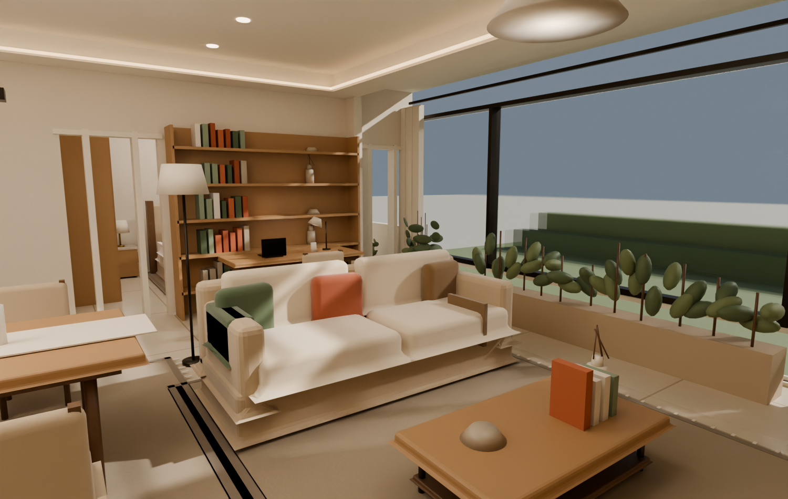

# Last House

**A reusable interior design workflow — currently demonstrated on a 143 m² four-bedroom apartment.**

[English](README.md) | [中文](README.zh-CN.md)

This is an end-to-end interior design study: a furniture plan, 24 photoreal renders, a style switcher, and three browser-based 3D scenes generated from the same spatial model.

The 143 m² four-bedroom plan is the current example. The workflow is layout-agnostic: add another scene graph, render folder, and style set to extend it to other apartments.



## Live site

- Design page: **https://lph12168x.github.io/last-house/design.html**
- 3D · Warm Cream: **https://lph12168x.github.io/last-house/?scene=your-house-warm**
- 3D · Modern Grey: **https://lph12168x.github.io/last-house/?scene=your-house-grey**
- 3D · Dark Luxe: **https://lph12168x.github.io/last-house/?scene=your-house-dark**

The design page switches all renders, material lists, and the 3D entry point together. The selected scheme is kept in the URL (`?style=warm|grey|dark`).

## Three schemes

| Scheme | Character | Key materials |
| --- | --- | --- |
| Warm Cream | Calm, lived-in, family-friendly | cream plaster, pale oak, linen, terracotta and sage accents, brass |
| Modern Grey | Restrained and orderly | light-grey walls, smoked oak, black metal, rust and olive accents |
| Dark Luxe | Warm, enveloping, evening-oriented | warm-grey walls, walnut, green velvet, cream stone, brass |

Each scheme includes eight 1500 × 950 views: overview, living room, TV wall, dining, kitchen, master bedroom, north bedroom, and a 3D top view.

## What is in the repo

- `public/design.html` — the multi-scheme presentation page
- `public/renders/<scheme>/` — eight final renders per scheme
- `public/renders/plan.png` / `plan.svg` — furniture plan with dimensions
- `public/scenes/your-house-<scheme>.json` — 3D scene graphs
- `public/items/<scheme>/` — style-specific furniture and joinery GLBs
- `src/` — the Vite + React viewer
- `scripts/blender/render.py` — procedural Blender scene and render setup
- `scripts/blender/make-style-assets.py` — generates the per-style GLBs
- `scripts/make-style-scenes.mjs` — builds the three 3D scene variants

## Run locally

```bash
npm ci
npm run dev
```

Open `http://localhost:5173/design.html` for the design page, or `http://localhost:5173/?scene=your-house-warm` for 3D.

Production build:

```bash
npm run build
npm run preview
```

## GitHub Pages

The site is deployed by GitHub Actions from `main` with Vite's base set to `/last-house/`. Re-deploy with a push to `main` or run the **Deploy GitHub Pages** workflow manually.

For a different repository name, set `GITHUB_PAGES_BASE=/<repo-name>/` in the workflow's build step.

## Notes

- The plan and dimensions are a design-stage proposal; verify on site before construction.
- 3D is a spatial and furniture-layout tool; material detail is best judged from the renders.
- The existing `LICENSE` is the GNU Affero General Public License v3.0.
